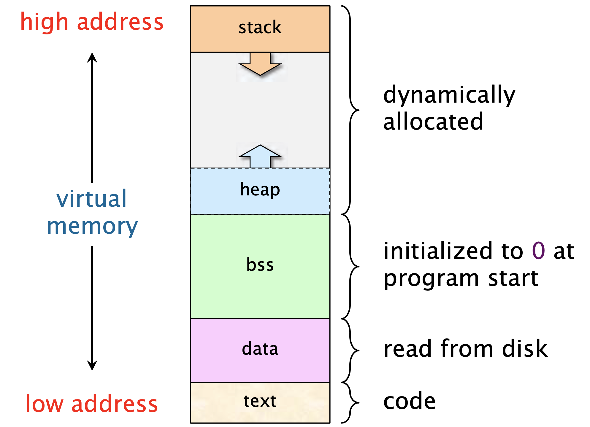
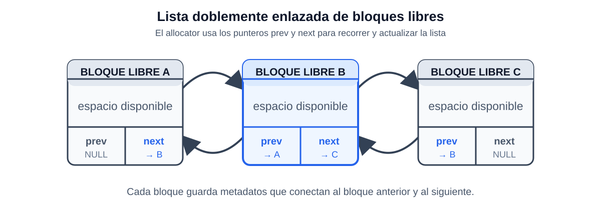
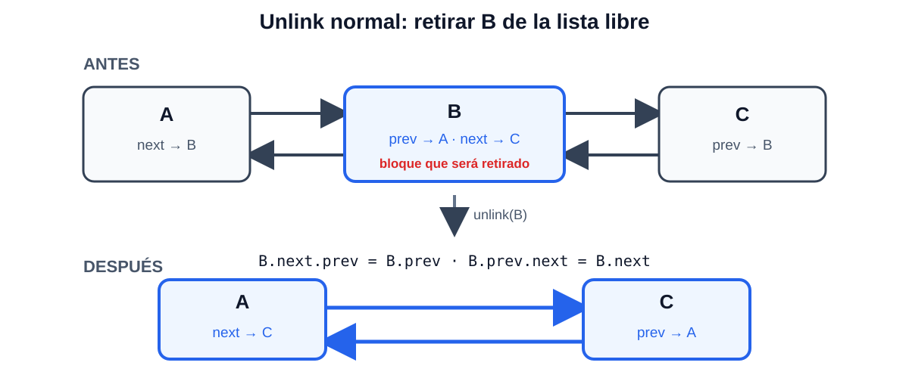
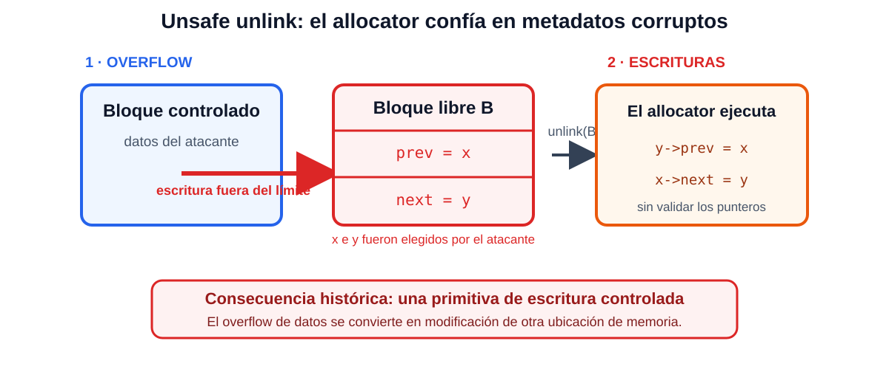

# Buffer Overflows

### IIC2531 — Clase 08

Desbordamiento de búfer en stack y heap:
de la vulnerabilidad a la explotación y las defensas.

---

# Objetivos de la clase

- Entender cómo se organiza la memoria de un proceso.
- Reconocer un buffer overflow y su origen en C.
- Explicar cómo se secuestra el flujo en el stack.
- Evaluar NX, canarios y ASLR, y sus limitaciones.
- Analizar el heap overflow y el *unsafe unlink*.

---

# Layout de memoria de un proceso

<style scoped>
ul { width: 42%; }
img[alt~="align-right"] {
  position: absolute;
  top: 160px;
  right: 40px;
  margin-top: 0px;
}
</style>

- **Código**: instrucciones del programa.
- **Datos**: variables globales y estáticas.
- **Heap**: `malloc`/`free`; crece hacia arriba.
- **Stack**: marcos de llamada; crece hacia abajo.



---

# Recordatorio de C: valores y punteros

```c
void modifyValue(int *p) { *p = 100; }

int main() {
    int x = 50;
    modifyValue(&x);   // pasa la dirección de x
    // x ahora vale 100
}
```

- `&x` obtiene la dirección; `*p` accede al valor apuntado.
- Pasar un puntero permite modificar la variable original.
- `malloc(sizeof(int))` reserva memoria en el heap.
- C no verifica límites: confía en el programador.

---

# ¿Qué es un buffer overflow?

- El programa escribe **más allá del final** de un búfer o array.
- En C no existe comprobación automática de límites.
- Corrompe variables vecinas, punteros o la dirección de retorno.
- Consecuencias: caída, fuga de datos o ejecución de código.
- Es una clase clásica de vulnerabilidad, con muchos ataques y defensas.
- Sigue vigente: casos de alto perfil como WhatsApp (2019).

---

# Ejemplo: `gets()` sin límites

```c
int read_req(void) {
  char buf[128];
  int i;
  gets(buf);        // copia hasta '\n', sin tamaño
  i = atoi(buf);
  return i;
}
```

- Entrada normal (`1234`): el programa funciona.
- Entrada larga: sobrescribe `buf`, `i`, `%rbp` y la dirección de retorno.
- Al ejecutar `ret`, el CPU salta a una dirección corrupta.
- Resultado: *crash* o control del flujo de ejecución.

---

# El stack frame y el desborde

```
        +------------------+
        |  marco main()    |
        +------------------+
        | dir. de retorno  |  <-- objetivo
        +------------------+
 %rbp → | %rbp guardado    |
        +------------------+
        |        i         |
        +------------------+
        |   buf[127] ...   |
 %rsp → |      buf[0]      |
        +------------------+
```

- `buf` está en el stack, seguido por `i` y la dirección de retorno.
- Escribir más de 128 bytes avanza hacia arriba en el diagrama.

---

# Cómo se secuestra el flujo de ejecución

- El ataque clásico tiene dos pasos:
  1. Escribir instrucciones (shellcode) en el búfer del stack.
  2. Sobrescribir el PC de retorno para apuntar a ellas.
- El código inyectado corre con los privilegios del proceso.
- Si es root/Administrator: control total del sistema.
- Si no: leer archivos, enviar spam o descargar más código.
- Dificultad: el atacante debe conocer o adivinar direcciones.

---

# Por qué C sigue siendo el problema

- Solución ideal: un lenguaje con límites verificados (Python, Java, C#).
- Reentrenar programadores y reescribir software es un gran esfuerzo.
- C está en sistemas operativos y librerías valiosas: no se abandona.
- La definición de C dificulta verificar límites con precisión.
- Ningún programador verifica límites el 100% del tiempo.
- Por eso: defensas que hagan la explotación más difícil.

---

# Defensa: NX (No eXecute)

- El SO marca las páginas del stack como **no ejecutables** (bit NX).
- Impide ejecutar instrucciones inyectadas en el stack.
- El ataque clásico de inyección de código deja de funcionar.
- No elimina el overflow: aún se puede corromper el flujo.
- No es solución completa: se puede reutilizar código existente.
- Se combina con canarios y ASLR.

---

# Defensa: stack canaries

- Valor secreto entre las variables locales y la dirección de retorno.
- El compilador lo inserta al entrar y lo verifica antes del `ret`.
- Si cambió, el programa aborta antes de usar la dirección corrupta.
- Valor típico: aleatorio, elegido al inicio y guardado aparte.
- **Detecta** la sobrescritura, pero no evita el desbordamiento.
- Ejemplos: StackGuard, Stack Smashing Protector (gcc).

---

# Defensa: ASLR

- Aleatoriza las direcciones de stack, código, heap y librerías.
- El atacante no conoce las direcciones exactas del proceso.
- Requiere soporte del compilador para hacer las secciones reubicables.
- Aumenta la entropía y encarece el ataque.
- No impide el overflow: solo dificulta apuntar al objetivo.
- Se puede derrotar con fugas de información o fuerza bruta.

---

# Límites de estas defensas

- **ASLR**: fugas de direcciones, ataques parciales o fuerza bruta.
- **Canarios**: si el atacante puede leer o escribir el valor secreto.
- Sobrescribir un puntero de función ubicado antes del canario.
- Corromper otra variable crítica sin tocar el canario:

```c
bool ok = true;
char buf[128];
gets(buf);
if (ok) { /* ... */ }
```

- Desbordar una variable global hacia la siguiente.
- Desbordar un búfer asignado en el heap.

---

# Buffer overflows en el heap

```c
void foo(void) {
  char *p = malloc(16);
  gets(p);          // desborda el bloque
}
```

- El código moderno usa mucho el heap: el ataque no es solo del stack.
- Tras el bloque vienen los **metadatos** del allocator.
- Allocators clásicos: bloques libres en lista doblemente enlazada.
- Los punteros `next` y `prev` son un objetivo atractivo.



---

# `unlink` normal

- Para retirar un bloque libre `b` de la lista doblemente enlazada:
  - `b->next->prev = b->prev;`
  - `b->prev->next = b->next;`
- Los vecinos quedan conectados directamente y la lista sigue consistente.
- La lista se mantiene en orden de dirección para fusionar bloques.



---

# Unsafe unlink: escritura controlada

- El atacante desborda un bloque y controla `prev` y `next` del siguiente.
- Si ese bloque libre es elegido por el siguiente `malloc()`, se ejecuta:
  - `y->prev = x;`
  - `x->next = y;`
- Con `x` e `y` controlados, escribe en direcciones elegidas.
- Puede sobrescribir punteros, incluida la dirección de retorno.
- El allocator se convierte en una primitiva de escritura arbitraria.



---

# Resumen

- El overflow nace de escribir fuera de los límites en C.
- En el stack se corrompe la dirección de retorno → secuestro del flujo.
- NX, canarios y ASLR elevan el costo, pero no son perfectos.
- En el heap, metadatos corruptos → *unsafe unlink* → escritura arbitraria.
- Un error pequeño puede combinarse con otros hasta dar control.
- El ataque exige varias piezas frágiles: un defensor puede romperlas.

---

# Pregunta de prueba 1

**¿Por qué `gets(buf)` es peligroso aunque la entrada parezca normal?**

**Respuesta:**

- No recibe el tamaño del búfer y copia hasta encontrar `\n`.
- Una entrada larga escribe sobre `i`, `%rbp` y la dirección de retorno.
- El desborde puede provocar un *crash* o control del flujo.
- La función es intrínsecamente insegura: debe evitarse.

---

# Pregunta de prueba 2

**¿Cómo permite un overflow de stack ejecutar código del atacante?**

**Respuesta:**

- Se inyectan instrucciones en el búfer del stack.
- Se sobrescribe la dirección de retorno para apuntar a ellas.
- El código corre con los privilegios del proceso.
- Se requiere conocer o adivinar la dirección del búfer.

---

# Pregunta de prueba 3

**¿Qué defensa impide ejecutar código inyectado y cuál detecta la corrupción del retorno? ¿Son suficientes?**

**Respuesta:**

- **NX**: marca el stack como no ejecutable e impide el shellcode.
- **Canarios**: detectan la modificación antes del `ret` y abortan.
- **ASLR** complementa ocultando las direcciones del proceso.
- Ninguna es completa: se combinan y aún quedan ataques.

---

# Pregunta de prueba 4

**Explica el *unsafe unlink* y qué primitiva entrega al atacante.**

**Respuesta:**

- Un overflow corrompe `prev` y `next` de un bloque libre.
- Al retirarlo, el allocator hace `y->prev = x` y `x->next = y`.
- Con `x` e `y` controlados se escribe en direcciones elegidas.
- Permite sobrescribir punteros de retorno o de función.
