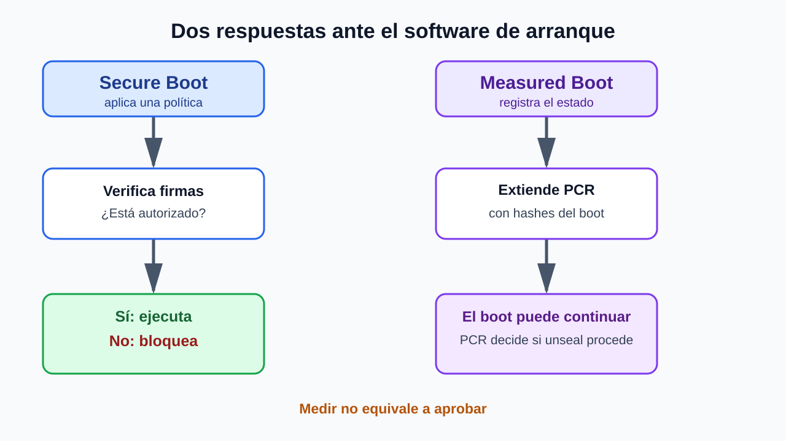
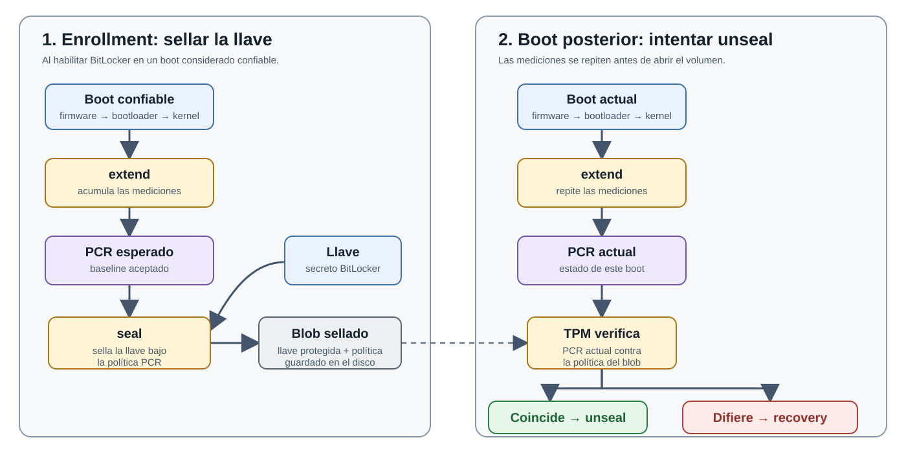
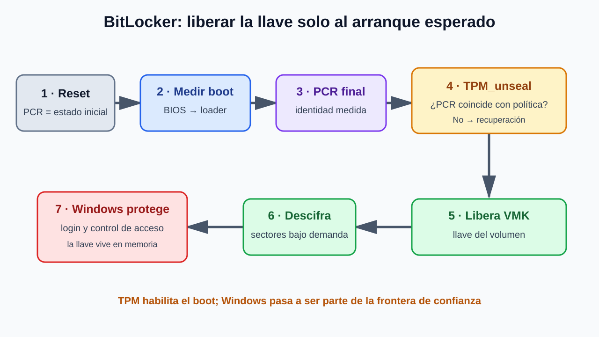

# Hardware confiable

## BitLocker y el costo de confiar en el arranque

**Modelo:** el adversario tiene control físico parcial de la computadora.

---

# BitLocker y el laptop robado

- BitLocker cifra los sectores del volumen de Windows.
- Sin la llave, extraer el disco solo entrega texto cifrado.
- El atacante puede extraer el disco, arrancar otro SO o modificar el boot.
- **Objetivo:** mantener confidenciales los datos aunque robe el equipo.
- El reto no es cifrar, sino **custodiar y liberar la llave**.

---

# Cifrar no basta

- Si la llave está legible en el disco, el atacante obtiene ambos.
- Si nunca está disponible, Windows tampoco puede arrancar.
- Si se libera durante el boot, importa **quién la recibe**.
- Una contraseña prearranque duplica el login y puede adivinarse.
- Una llave USB separa el secreto, pero agrega un objeto que se pierde.

---

# Liberación automática y su condición

- BitLocker quiere abrir el volumen sin PIN ni USB.
- La liberación no puede ser incondicional: un boot modificado pediría la llave.
- La llave se asocia a una **configuración esperada del arranque**.
- Si el estado coincide, se libera; si no, queda protegida.
- Se necesita hardware que observe el boot y aplique la política.

---

# Secure Boot: impedir lo no autorizado

- Código inicial inmutable contiene una llave pública.
- Verifica la firma del bootloader antes de ejecutarlo.
- El bootloader verifica el kernel; el kernel autentica lo siguiente.
- Política: firma válida autoriza; firma inválida detiene el arranque.
- Ejemplos: UEFI Secure Boot, consolas, iOS, Chrome OS Verified Boot.

---

# Autenticar mucho código sin leerlo todo

- Verificar toda la imagen del OS de una vez es costoso.
- Firma de una **raíz Merkle**: cada bloque trae una prueba al leerse.
- BitLocker usa una garantía más débil: cifra sectores y dificulta corrupción útil.
- **Rollback:** firmware sin estado acepta una versión antigua firmada pero vulnerable.
- Un contador monotónico puede fijar la versión mínima permitida.

---

# TPM y Measured Boot

- TPM = Trusted Platform Module: chip pequeño, aislado del SO y del disco.
- Guarda registros protegidos, secretos y ejecuta criptografía limitada.
- Cada etapa hashea la siguiente **antes** de ejecutarla.
- Las mediciones se acumulan en **PCR** (Platform Configuration Registers).
- El TPM no decide si el software es seguro: conserva evidencia del boot.

---

# Secure Boot vs Measured Boot

- Secure Boot **bloquea** software no autorizado.
- Measured Boot **registra** lo ejecutado y permite políticas sobre el estado.
- Permite condicionar secretos, hacer attestation y separar “observado” de “autorizado”.
- No garantiza que el software medido sea seguro ni que el hardware esté intacto.

---

# Operaciones del TPM

- `extend(n, m)`: `PCRn ← H(PCRn ∥ m)`.
- `seal(política PCR, secreto)`: produce ciphertext ligado a un estado.
- `unseal(ciphertext)`: libera el secreto solo si el PCR cumple la política.
- `quote(n, nonce)`: firma PCR más un desafío para attestation.
- `extend` registra, `seal`/`unseal` protegen la llave; `quote` convence a terceros.

---

# Cadena de medición

1. Al reset, CPU y TPM se reinician juntos; los PCR parten de un valor conocido.
2. El BIOS se mide y extiende el PCR.
3. El BIOS mide el bootloader; luego lo ejecuta.
4. El bootloader mide el kernel; luego lo ejecuta.
5. El kernel mide lo que carga después.

**Supuestos delicados:** la CPU parte de un BIOS no manipulado y el atacante no desacopla el reset del TPM.

---

# Extend + seal/unseal

- El secreto no se guarda en claro “dentro del TPM”: se guarda **sellado**.
- La política describe los PCR esperados.
- Un estado distinto produce un `unseal` fallido.
- Las mediciones no generan una llave nueva: condicionan la liberación de una existente.

---

# ¿Qué prueba realmente un PCR esperado?

- Es **consistente con** la cadena de software esperada, no una prueba absoluta.
- Una etapa medida puede contener un bug explotable.
- Desde ahí, el atacante podría emitir sus propios `extend`.
- La CPU podría no haber comenzado en el BIOS previsto.
- CPU y TPM podrían no haberse reseteado sincrónicamente.

---

# BitLocker en modo TPM

- La llave de volumen se almacena sellada bajo una política PCR.
- El TPM la libera al reconocer el arranque medido; luego aparece el login.
- Después de liberarla, Windows la mantiene en memoria.
- Si comprometen el kernel en ejecución, BitLocker ya no impide leer el disco.

---

# Ataques que detiene el modo solo-TPM

- **Disco extraído o copiado:** otro TPM no puede liberar la llave sellada.
- **Boot modificado en el mismo laptop:** cambian los PCR y entra en recuperación.
- **Boot normal en el mismo laptop:** la llave se libera y el atacante llega al login.
- Protege contra lectura offline y cambios del boot medido sin exigir PIN.
- No protege un Windows ya desbloqueado y comprometido.

---

# ¿Qué se mide y qué no?

- Se mide la **ruta de arranque**: firmware, bootloader y componentes cubiertos.
- No se hashea todo el volumen en cada arranque: es grande y cambia.
- Tras liberar la llave, Windows descifra y cifra sectores bajo demanda.
- Un PCR esperado valida la ruta de arranque, no cada archivo del disco.
- Actualizar una partición medida exige re-sellar la política.

---

# Integridad y “autenticación del pobre”

- El cifrado oculta el plaintext, pero no detecta cambios en el ciphertext.
- Ideal: un MAC por sector, verificado antes de usar el dato.
- Sector adyacente: casi duplica espacio y exige dos escrituras atómicas.
- BitLocker difunde cambios (*shuffling*): corrupción útil y predecible es difícil.
- No equivale a un MAC: manipulación y corrupción siguen sin autenticarse.

---

# Rollback, DMA y cold boot

- **Rollback:** un sector cifrado antiguo sigue siendo ciphertext válido; no hay versión por sector.
- **DMA:** dispositivos de alta confianza pueden leer memoria con la llave.
- **Cold boot:** la DRAM conserva remanencia tras reiniciar.
- **Enlace CPU–TPM:** puede observarse o alterarse la liberación.
- BitLocker protege datos en reposo, no un sistema en ejecución.

---

# Matriz de garantías y conclusión

| Propiedad | Resultado |
|---|---|
| Confidencialidad de disco robado | Fuerte dentro del modelo |
| Arranque esperado antes de unseal | Condicionado por PCR y supuestos HW |
| Integridad por sector | No; mitigación probabilística |
| Frescura / anti-rollback | No |
| DMA / cold boot / kernel comprometido | Fuera de protección |

- Secure Boot bloquea; Measured Boot registra y habilita políticas.
- El precio: integridad débil, sin frescura y exposición tras entregar la llave.

---

# Pregunta de prueba 1

**¿Por qué el cifrado de disco por sí solo no resuelve el robo de un laptop?**

**Respuesta:**
- El cifrado necesita una llave de desencriptación.
- Si la llave está en el disco, el atacante obtiene ambos.
- Si se libera en el boot, hay que decidir quién la recibe.
- El problema real es la custodia y liberación de la llave.

---

# Pregunta de prueba 2

**¿Cuál es la diferencia entre Secure Boot y Measured Boot?**

**Respuesta:**
- Secure Boot verifica firmas y **detiene** software no autorizado.
- Measured Boot hashea cada etapa y **registra** el estado en los PCR.
- Secure Boot aplica una política de autorización.
- Measured Boot permite condicionar secretos y hacer attestation.

---

# Pregunta de prueba 3

**¿Cómo libera BitLocker su llave usando el TPM?**

**Respuesta:**
- La llave se guarda **sellada** bajo una política de PCR.
- El arranque extiende los PCR con cada componente medido.
- `unseal` entrega la llave solo si el estado coincide.
- Si no coincide, BitLocker pide recuperación; el TPM no almacena la llave en claro.

---

# Pregunta de prueba 4

**¿Qué ataques quedan fuera de las garantías de BitLocker?**

**Respuesta:**
- Modificación de ciphertext: no hay MAC fuerte por sector.
- Rollback a versiones antiguas: no hay frescura.
- DMA y cold boot: pueden extraer la llave de memoria.
- Kernel de Windows comprometido después del desbloqueo.
