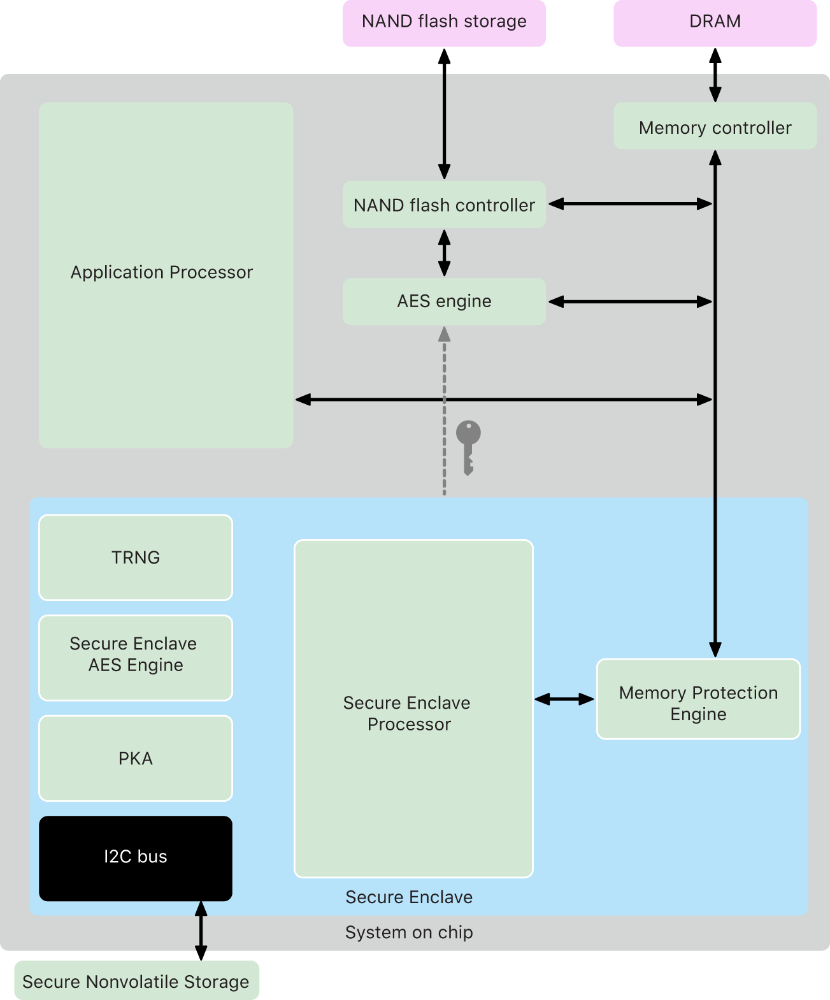

# Seguridad de dispositivos móviles

### IIC2531 — Clase 11

Diseño de iOS frente a un teléfono robado:
arranque, enclave, claves y datos.

---

# La amenaza y por qué importa

- Alguien roba el iPhone y quiere extraer sus datos.
- Apple tiene clientes con secretos: médicos, gobiernos, periodistas.
- Usuarios comunes temen por contraseñas bancarias y fotos.
- Es una ventaja competitiva frente a otras plataformas.
- El diseño asume que el **código de acceso** protege el dispositivo.

---

# Supuestos y ataques potenciales

- El equipo está bloqueado al momento del robo y tiene passcode.
- Ataques: fuerza bruta del PIN (a menudo cuatro dígitos).
- Suplantar huella o rostro; desarmar el teléfono y leer flash o DRAM.
- Explotar el kernel desde USB, WiFi o radio activos en segundo plano.
- Instalar un SO modificado o degradar a una versión antigua vulnerable.

---

# Arquitectura de hardware

- CPU principal, RAM y almacenamiento flash.
- Motor AES entre CPU/DRAM y el almacenamiento.
- CPU separada para el **Secure Enclave**.
- Clave `UID` grabada en el hardware del enclave.
- Sensores autenticados: Touch ID y cámara Face ID.

---

# Vista de arquitectura

- El enclave puede cifrar o descifrar con `UID`, pero no puede leerlo.
- La CPU principal nunca ve las claves criptográficas.
- El motor AES aplica cifrado sin exponer secretos al kernel.

---

# Arranque seguro

- Objetivo: impedir que el adversario ejecute SO, apps o enclave modificados.
- Al encender, la CPU ejecuta la **Boot ROM**, solo lectura y fijada en fabricación.
- Secuencia: Boot ROM → iBoot → kernel → apps.
- Boot ROM verifica la firma de iBoot; iBoot la del kernel.
- El kernel verifica que las apps estén firmadas por un desarrollador aprobado.

---

# Anti-degradación con ECID

- Ataque: instalar un kernel antiguo firmado por Apple pero con un bug conocido.
- Registrar versiones no basta: el atacante podría modificar el registro.
- Cada chip tiene un **ECID** único, de solo lectura, fijado en fabricación.
- Apple firma actualizaciones para un ECID específico.
- El boot verifica que la firma corresponda a este teléfono y rechaza versiones obsoletas.

---

# Secure Enclave

- CPU separada con su propia secuencia de arranque seguro.
- Oculta claves a la CPU principal y controla toda la criptografía.
- Defiende contra adivinación del passcode y autentica al usuario.
- Comparte DRAM, pero cifra su memoria y autentica integridad y frescura.
- El estado de autenticación de memoria vive en SRAM dentro del chip.

---

# Autenticación de usuario y sensores

- Plan: datos cifrados; descifrar solo con el teléfono desbloqueado.
- Delegar al enclave evita que un kernel comprometido robe claves o salté reintentos.
- Mecanismo primario: passcode; adicionales: huella y rostro.
- Sensores y enclave comparten una clave AES y autentican sus mensajes.
- Nonces o IDs de sesión impiden repetir lecturas antiguas o sustituir sensores.

---

# Claves derivadas del passcode

- La clave de datos es aproximadamente `E_UID(E_UID(...(passcode)))`.
- Depende del passcode: no existe en el dispositivo después de reiniciar.
- Depende del `UID`: impide fuerza bruta fuera del teléfono.
- Se calcula dentro del enclave, que limita intentos.
- Es deliberadamente lenta para reducir la velocidad de búsqueda.

---

# Aplicaciones en segundo plano

- Al bloquear, las claves se olvidan, pero algunas apps deben seguir operando.
- Ejemplo: descargar adjuntos de correo con el teléfono bloqueado.
- Solución: **envoltorio de claves** `E_k1(k2)`.
- Quien conoce `k1` obtiene `k2`; se delega acceso entre módulos.
- Se usan claves de protección distintas según el nivel de acceso permitido.

---

# Cifrado de archivos

- Metadatos del sistema de archivos cifrados con una única clave `Kfs`.
- El enclave guarda `E_UID(Kfs)` y entrega `E_Ke(Kfs)` al kernel al arrancar.
- Cada archivo tiene su propia clave `Kf`, envuelta como `E_Kdp(Kf)`.
- La clave envuelta se almacena en los metadatos del archivo.
- Distintos `Kdp` corresponden a distintos niveles de protección.

---

# Clases de Data Protection

- **Completo:** descifra solo con el teléfono desbloqueado; `Kdp` se descarta al bloquear.
- **Completo hasta cerrar:** permite escribir en segundo plano, no leer.
- **Hasta primera autenticación:** clave desde el primer desbloqueo; se pierde al apagar.
- **Sin protección:** `Kdp` deriva solo del `UID`; disponible desde el arranque.
- Los `Kdp` se almacenan únicamente en el Secure Enclave.

---

# Claves envueltas y motor AES

- El sistema de archivos solo ve claves envueltas y pide al enclave desenvolverlas.
- El kernel **nunca obtiene claves crudas**.
- El enclave comparte `Ke` con el motor AES de hardware.
- Entrega `E_Ke(Kf)` y el kernel programa el motor para cifrar o descifrar.
- Así el software privilegiado opera sin conocer el secreto.

---

# Touch ID y Face ID

- No se pueden usar inmediatamente tras reiniciar: primero hace falta el passcode.
- Al ingresarlo, el enclave calcula los `Kdp` y guarda copias cifradas.
- Al bloquear, el enclave elimina los `Kdp`.
- Una autenticación biométrica correcta permite recuperarlos.
- Face ID proyecta puntos IR y lee profundidad, lo que ayuda a distinguir un rostro 3D de una foto.

---

# Borrado seguro

- Objetivo: borrar rápido y también tras 10 intentos fallidos.
- Borrar todo el flash es lento y la nivelación de desgaste deja copias.
- Solución: **almacenamiento borrable** con acceso NAND de bajo nivel para el enclave.
- Allí se guarda `E_UID(Kfs)`.
- Destruir esa clave vuelve ilegibles todos los datos, sin borrar cada bloque.

---

# Debilidades del diseño

- El kernel de la CPU principal ve passcode, datos descifrados y contraseñas.
- Errores del kernel explotables por apps dan root, aunque no se instalan apps nuevas estando bloqueado.
- El código de arranque puede tener fallos y aceptar kernels que permiten adivinar el passcode.
- USB, WiFi y radio están activos con el teléfono bloqueado y tienen bugs.
- Las claves privadas de Apple deben firmar actualizaciones y mantenerse seguras.

---

# Costos y resumen

- Hardware especializado: enclave, sensores biométricos y motor AES.
- Escribir el passcode resulta incómodo y se necesita en muchas situaciones.
- Las tareas en segundo plano se vuelven complicadas.
- Passcode olvidado implica pérdida permanente sin respaldo.
- Ideas clave: arranque firmado con ECID, enclave aislado, claves derivadas, envoltorio y borrado criptográfico.

---

# Pregunta de prueba 1

**¿Qué ataques intenta detener el diseño y bajo qué supuestos?**

**Respuesta:**
- Robo físico con el teléfono bloqueado y protegido por passcode.
- Fuerza bruta del PIN, suplantación biométrica y extracción de flash o RAM.
- Explotación del kernel desde radios activas e instalación de SO modificado.
- Degradación a versiones antiguas con vulnerabilidades conocidas.

---

# Pregunta de prueba 2

**¿Cómo funciona la prevención de degradación con ECID?**

**Respuesta:**
- Cada chip tiene un ECID único y de solo lectura.
- Apple firma las actualizaciones para un ECID específico.
- El arranque verifica que la firma corresponda a ese dispositivo.
- Un atacante no obtiene fácilmente software antiguo firmado para la víctima.

---

# Pregunta de prueba 3

**¿Por qué la clave de datos se deriva del passcode y del UID?**

**Respuesta:**
- Derivarla del passcode hace que no exista tras reiniciar y se olvide al bloquear.
- Derivarla del UID impide la fuerza bruta fuera del dispositivo.
- El cálculo ocurre en el enclave, que limita los intentos.
- Es lento a propósito para reducir la tasa de adivinación.

---

# Pregunta de prueba 4

**¿Cómo se logra el borrado seguro sin borrar todo el flash?**

**Respuesta:**
- Los datos se cifran con claves; `Kfs` protege los metadatos.
- `E_UID(Kfs)` se guarda en almacenamiento borrable accesible al enclave.
- Destruir esa clave deja los datos ilegibles de inmediato.
- Evita el costo y las copias residuales inherentes a borrar todo el flash.
