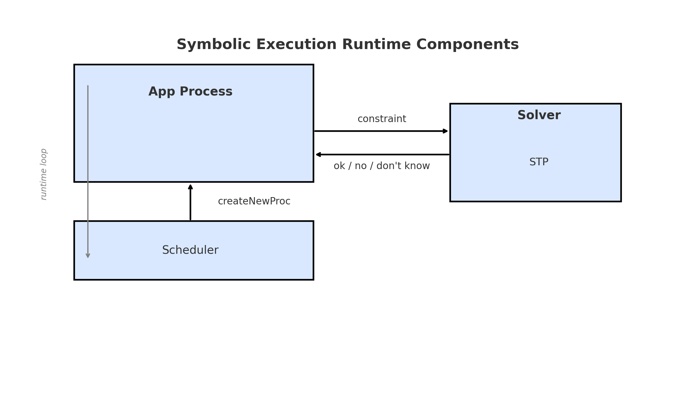

# Bugs y Ejecución Simbólica

Automatizar la búsqueda de vulnerabilidades con EXE

---

# Bugs: fuente principal de exploits

- Un bug no siempre es explotable, pero debemos asumir que puede serlo
- No todo buffer overrun produce un exploit, pero el atacante solo necesita uno
- Alternativa: que investigadores encuentren los bugs primero
  - Contactar al vendedor
  - Divulgar tras un plazo (p. ej. 90 días)
- CVE: registro comunitario de vulnerabilidades y exposiciones
- Muchas empresas pagan bug bounties por reportes

---

# Enfoque: entradas del atacante + asserts

- La aplicación recibe entradas que el atacante controla
- Agregamos verificaciones de situaciones malas
  - División por cero, puntero nulo, índice fuera de rango
  - Asserts propios de la aplicación
- Los asserts pueden ser caros en producción: se apagan al desplegar
- Pregunta central: ¿qué entrada hace fallar una verificación?
- El atacante puede usar la misma técnica para hallar el fallo

---

# Testing: fortalezas y límites

- Cada prueba ejecuta el programa con una entrada y conoce la salida esperada
- Pro: valida funcionalidad intencionada y bugs ya conocidos
- Con: no cubre funcionalidad no intencionada, es decir, vulnerabilidades
- Con: no encuentra bugs aún desconocidos
- Con: la cobertura completa es difícil; una línea nunca ejecutada oculta sus bugs
- Con: escribir pruebas cuesta esfuerzo y tiende a sesgarse a lo esperado

---

# Fuzzing: la idea

- Ejecutar el programa con muchas entradas generadas automáticamente
- Paso 1: identificar fuentes de entrada (argumentos, archivos, HTTP)
- Paso 2: escribir un generador de entradas
  - Totalmente aleatoria rara vez llega profundo (`if method == "GET"`)
  - Generar entradas sintácticamente válidas con contenido aleatorio
  - Reutilizar el conjunto de pruebas como semilla
- Paso 3: ejecutar hasta aburrirse y observar crashes o asserts

---

# Fuzzing: por qué funciona

- Ampliamente usado y con muchos bugs reales encontrados
- Muy bueno para buffer overflows: basta un valor fuera de rango
- No siempre requiere escribir un assert
- Mejor que un programador adivinando comportamientos inesperados
- No necesita controlar todo el entorno: sirve en caja negra por red
- Puede funcionar sin código fuente, si hay forma de detectar el error

---

# Fuzzing: límites

- Consume mucho tiempo de CPU
- Cobertura difícil: puede no probar nunca una rama concreta
  - `if command == "credit"` requiere acertar el valor
- Entradas con estructura compleja son casi imposibles al azar
  - Probar un compilador con bytes aleatorios es inviable
- Encontrar un crash no explica la causa ni garantiza explorar el resto

---

# Ejecución simbólica: la idea

- Objetivo: encontrar bugs profundos conduciendo el programa por todos sus caminos
- En vez de valores concretos, calcular con valores simbólicos
- En cada `if`, crear una condición de camino para la rama verdadera y otra para la falsa
- Usar un solver de restricciones para decidir si una rama es alcanzable
- Si el camino es satisfacible, el solver entrega entradas concretas que lo activan

---

# Valores simbólicos

```
int x = 5;
int y = α;
int z = 2 * y;

if (10 * x == z)
  panic();
```

- `α` representa cualquier valor de entrada, no un número fijo
- `z` queda como la expresión `2 * α`
- La condición es `10 * 5 == 2 * α`, es decir `α == 25`
- El solver resuelve y reemplaza `α` por un valor concreto

---

# Estado de EXE

- Cada variable o ubicación de memoria contiene una expresión sobre las entradas
- Tabla de rangos simbólicos: arreglo de bytes, 8 bits simbólicos cada uno, independiente del tipo C
- Path constraint (PC): restricciones acumuladas por los `if` ejecutados
- Al llegar a `error()` o a un assert, se consulta si el PC es satisfacible
- Si lo es, STP entrega los valores de entrada que disparan el fallo
- Sin punto flotante; sin interacción simbólica con el sistema operativo

---

# El árbol de caminos y fork()

- EXE ve la ejecución como un árbol que se bifurca en cada `if`
- Un proceso sigue la rama verdadera; otro, la falsa
- Cada `fork()` agrega la condición (o su negación) al PC del hijo
- Los procesos contactan a un servidor de búsqueda y esperan turno
- Estrategia **best-first**: prioriza la línea ejecutada menos veces
  - Se acerca a breadth-first para no quedar atascado
  - Aplica DFS en ese proceso y sus hijos "por un rato"

---

# EXE es un traductor C-a-C

- Transforma el código C instrumentado y luego compila con gcc
- Cubre todo C excepto punto flotante
- En cada asignación, expresión y rama agrega código
  - Si hay argumentos simbólicos, marca el resultado y registra su expresión
  - Si todos son concretos, ejecuta la operación ordinaria, más rápida
- En cada rama hace `fork()` y actualiza el PC de cada hijo
- El resultado es código C normal: portable y fácil de compilar

---

# Visión general en ejecución



- Cada proceso explora un camino y consulta al servidor de búsqueda
- El estado compartido permite decidir qué rama vale la pena ejecutar
- Los hallazgos se reportan como entradas concretas que violan un assert

---

# Un ejemplo difícil para humanos y fuzzers

```
1. read x, y
2. if x > y:
3.   x = y
4. if x < y:
5.   x = x + 1
6. if x + y == 7
7.   error()
```

- La línea 6+7 expande el assert `x + y != 7`
- Decidir si el atacante puede disparar el error exige razonar con cuidado
- Un fuzzer aleatorio necesitaría mucha suerte para dar con los valores
- La ejecución simbólica lo deduce recorriendo los caminos

---

# Dos caminos, dos restricciones

- Camino A: `pc = {α > β}`, luego `x = β`
  - El segundo `if` no puede entrar
  - La consulta `β + β == 7` no es satisfacible: sigue sin error
- Camino B: `pc = {α <= β}`, luego `{α <= β ∧ α < β}`, `x = α + 1`
  - Consulta `(α + 1 + β) == 7` con `α < β`
  - Hay soluciones, por ejemplo `α = 0`, `β = 6`
- EXE reporta la falla del assert junto con esas entradas concretas

---

# El solver de restricciones

- Es la parte realmente difícil de la ejecución simbólica
- Resuelve conjuntos de ecuaciones sobre los valores simbólicos
  - Fácil: `x + y = 10 ∧ x = y`
  - Difícil: `900 = x * x`; requiere trucos que STP conoce
  - Muy difícil: `10 = sha1(x)`; el tiempo se agota
- Cada nueva restricción de rama implica una consulta al solver
- Sin solver habría que intentar todas las ramas a ciegas; elegir una al azar perdería caminos

---

# Lo que EXE no puede garantizar

- No sabe qué es un bug: encuentra crashes y asserts violados, nada más
- El solver puede agotar el tiempo antes de hallar la entrada
- Puede no explorar todos los caminos: el número puede ser enorme
- Sin punto flotante y sin llamadas al SO con argumentos simbólicos
- Ausencia de hallazgos no prueba ausencia de bugs
- En la práctica encontró bugs reales en filtros BPF, udhcpd, pcre y sistemas de archivos

---

# Ejecución concólica

- Problema: no siempre podemos mirar dentro de una función (p. ej. `DBlookup`) ni ejecutarla simbólicamente
- Solución: ejecutar con entradas concretas, como la cadena vacía, para que la función opaca corra normalmente
- Mientras se ejecuta, registrar valores simbólicos derivados de las entradas y mantener el PC del único camino
- Al terminar, negar una condición `if` del PC y resolver hasta ese punto
- Se obtienen nuevas entradas concretas y se re-ejecuta por otro camino
- Repetir negando distintas ramas para cubrir más caminos

---

# Trade-offs y conclusión

- Concólico: fácil de agregar a lenguajes como Python mediante tipos "proxy"
  - Tolera funciones opacas sin instrumentarlas
  - Pero pierde restricciones (la relación entre `ok` y `u`) y puede no cubrir ramas
- Simbólico puro: más preciso, pero requiere instrumentar todo el programa
- La ejecución simbólica es potente y productiva en programas pequeños
- Se vuelve menos práctica a medida que el programa crece
- Herramientas: S2E, SAGE (Microsoft), GrammaTech; base del Laboratorio 3

---

# Preguntas de prueba (1/2)

**1. ¿Por qué un fuzzer puede no encontrar un bug que la ejecución simbólica sí descubre?**

**Respuesta:**
- El fuzzer prueba entradas concretas y puede no alcanzar ramas profundas.
- Necesita acertar valores o estructuras específicas, como `command == "credit"`.
- La ejecución simbólica razona sobre caminos y resuelve las restricciones.

**2. ¿Qué representa el path constraint y para qué se consulta al solver?**

**Respuesta:**
- Es el conjunto de restricciones impuestas por los `if` recorridos.
- Se consulta para saber si el camino actual es satisfacible.
- Si lo es, el solver entrega entradas concretas que alcanzan el fallo.

---

# Preguntas de prueba (2/2)

**3. ¿Qué gana y qué pierde la ejecución concólica frente a la simbólica pura?**

**Respuesta:**
- Gana facilidad de integración y tolerancia a funciones opacas.
- Gana ejecución real de código que no se puede instrumentar.
- Pierde restricciones, por lo que algunas ramas quedan inexploradas.

**4. Si EXE no encuentra bugs, ¿puede afirmarse que el programa es seguro?**

**Respuesta:**
- No: EXE solo detecta crashes y asserts violados.
- El solver puede agotar el tiempo sin hallar una entrada válida.
- Puede quedar una cantidad enorme de caminos sin explorar.
