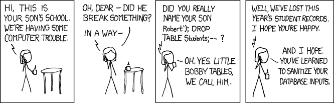

# Seguridad Web: la Same-Origin Policy

### IIC2531 — Clase 16

Aislamiento entre sitios, cookies y los ataques que rodean al navegador.

---

# Una historia de seguridad retrofitada

- Al inicio la web era texto e imágenes: no parecía haber un problema de seguridad.
- JavaScript y los sitios sensibles (banca, correo, comercio) cambiaron todo.
- Los riesgos no fueron evidentes hasta mucho después.
- Los diseños iniciales son difíciles de asegurar y de cambiar.
- La compatibilidad con sitios y navegadores antiguos pesa mucho.
- Los usuarios priorizan conveniencia sobre seguridad.
- Resultado: seguridad añadida "por al lado", no explícita desde el diseño.

---

# Modelo de amenaza

- El atacante controla un sitio, `attacker.com` (p. ej. `dog-photos.com`).
- La víctima lo visita mientras usa el mismo navegador para correo, banca, etc.
- El navegador y su sandbox se consideran confiables.
- Se asume que no hay errores de implementación (buffer overflows) en el navegador.
- Para esta clase, la red se considera segura: el foco es el aislamiento entre sitios.
- Lo que el atacante controla es el HTML y JavaScript que el navegador ejecuta.

---

# El problema central

- El navegador sigue instrucciones de sitios que no conocemos.
- Ejecuta HTML y JavaScript del atacante dentro de un sandbox.
- El sandbox impide leer archivos locales y limita el acceso al sistema.
- Pero muchas acciones "solo web" son dañinas: leer correo, actuar en el banco, mirar otras ventanas, acceder a la intranet.
- La meta es que el código de un sitio no abuse de los privilegios de otro.

---

# Same-Origin Policy (SOP)

- El navegador etiqueta cada script y recurso con un origen.
- Origen = protocolo + host + puerto.
- `https://foo.com/x/y/z` tiene origen `https://foo.com:443`.
- Todas las páginas de un mismo servidor comparten origen.
- Regla: un script solo accede a recursos del mismo origen.
- La unidad de aislamiento es el iframe (pestaña superior o frame embebido).
- SOP a la vez aísla y autoriza cierto intercambio controlado.

---

# SOP en acción: XMLHttpRequest

- `XMLHttpRequest(url)` permite a JavaScript obtener una URL y leer la respuesta.
- Se usa para consumir APIs web y cargar datos sin recargar la página.
- Si `attacker.com` intenta leer `gmail.com`, el navegador bloquea la lectura por SOP.
- Solo puede leer respuestas del mismo origen del script.
- El atacante puede engañar al usuario para que visite Gmail, pero entonces el navegador ejecuta código de Gmail, no del atacante.

---

# ¿Cómo se mantiene el aislamiento?

- Para saber que los datos vienen de `gmail.com`: TLS y un certificado con el nombre DNS.
- Para saber que el comando viene del navegador del usuario: cookies.
- Ambas piezas son necesarias y cada una tiene sus propios supuestos y fallas.
- El certificado autentica al servidor; la cookie autentica la sesión del usuario.
- SOP opera sobre esas identidades, no sobre la "intención" del código.

---

# Cookies

- Permiten estado en un protocolo sin estado: carrito, preferencias, sesión, rastreo.
- El servidor las crea con `Set-Cookie: key=value`.
- El navegador las reenvía automáticamente en cada solicitud al dominio correspondiente.
- El dominio debe ser sufijo del nombre DNS del sitio; `domain=google.com` cubre `mail.google.com`.
- Tras el login se entrega un `sessionID` largo y aleatorio.
- Ese identificador debe mantenerse secreto: quien lo tenga puede actuar como el usuario.

---

# Problemas de cookies

- El envío automático es la raíz de muchos ataques: el servidor no distingue si la petición la originó el usuario o un tercero.
- `SameSite=Strict` no las envía en solicitudes de otro origen, pero rompe flujos esperados (llegar a Facebook desde un enlace y ver login).
- `SameSite=Lax` las envía al navegar con enlaces: recupera conveniencia y parte del riesgo.
- Chrome adoptó `Lax` por defecto.
- Sobrescritura: un sitio no debe poder fijar cookies de otro; la regla de sufijo y la lista de dominios de nivel superior lo impiden.
- Sin esa lista, `attacker.com` podría intentar fijar una cookie para `.com`.

---

# Excepciones al SOP: enlaces e imágenes

- **Enlaces:** una página puede enlazar a cualquier sitio; es esencial para la web.
  - El navegador envía las cookies del destino: el clic ocurre como el usuario de ese sitio.
- **IMG:** se puede incrustar una imagen de cualquier origen.
  - Evita copias y facilita contenido; el navegador aplica SOP a los píxeles, así que el atacante no lee la imagen.
  - Pero la solicitud lleva cookies del sitio de la imagen: puede tener efectos secundarios.

---

# Excepciones al SOP: SCRIPT e IFRAME

- **SCRIPT:** ``.
- Si no lo impide, el código del atacante corre en el navegador de la víctima.
- El sandbox no basta: el script se ejecuta con el origen del sitio, p. ej. `facebook.com`.
- Puede leer la cookie de sesión, actuar como el usuario o enviársela al atacante.
- La inyección mezcla datos con código: el mismo principio aparece en SQL.

---

# Defensas contra XSS

- `HttpOnly`: la cookie no es visible para JavaScript.
  - No es completo: el script aún puede hacer solicitudes como el usuario.
- Escapar o eliminar HTML del contenido generado por usuarios.
- Parsear y permitir solo etiquetas seguras con una biblioteca probada; no inventar filtros.
- `Content-Security-Policy`: el servidor prohíbe scripts inline y limita orígenes.
- Validar también archivos subidos: una "foto" puede ser JavaScript.
- Los mecanismos retrofitados rara vez dan garantías precisas; defensa en capas.

---

# Clickjacking y defensas

- El navegador trata cada clic como una autorización completa del usuario.
- Las pistas visuales son la base para entender las consecuencias de un clic.
- Ataque: `attacker.com` incrusta Amazon en un iframe invisible (`opacity:0`) y pinta "iPad gratis" encima.
- El clic compra el artículo sin que el usuario vea el frame real.
- Defensa: `X-Frame-Options: DENY` impide el framing.
- `Content-Security-Policy: frame-ancestors 'none'` es la versión moderna.
- El problema de fondo: el HTML no siempre comunica qué se está autorizando.

---

# Resumen: complicado, pero adecuado

- SOP bloquea una gran clase de ataques y sigue siendo la base del aislamiento web.
- Las excepciones (enlaces, IMG, SCRIPT, IFRAME, CORS) son necesarias y crean riesgo.
- Cookies y TLS sostienen el modelo; el envío automático de cookies habilita CSRF.
- XSS rompe SOP al ejecutar código con el origen de la víctima.
- Defensas: tokens, `HttpOnly`, sanitización, CSP, `SameSite`, `X-Frame-Options`.
- Rediseñar desde cero choca con compatibilidad, expresividad y evolución.
- Los frameworks ayudan, pero no eliminan la necesidad de entender el modelo.

---

# Pregunta de prueba 1

**Define origen y explica por qué `https://foo.com` y `http://foo.com` son distintos.**

**Respuesta:**

- Origen = protocolo + host + puerto.
- `https` y `http` son protocolos distintos, aunque el host coincida.
- Por eso el navegador los trata como orígenes separados.
- Un script de uno no puede leer recursos del otro sin una excepción explícita.

---

# Pregunta de prueba 2

**¿Por qué `attacker.com` no puede leer la respuesta de `gmail.com` con XMLHttpRequest? ¿Qué cambia CORS?**

**Respuesta:**

- SOP permite leer solo respuestas del mismo origen del script.
- La solicitud puede enviarse, pero el navegador oculta la respuesta.
- CORS deja que el servidor autorice explícitamente el origen solicitante.
- Sin autorización del servidor, la lectura sigue bloqueada.

---

# Pregunta de prueba 3

**Explica CSRF y por qué un token aleatorio la mitiga.**

**Respuesta:**

- El sitio atacante hace que el navegador envíe una petición con la cookie de la víctima.
- El servidor la interpreta como una acción legítima del usuario.
- El token impredecible debe acompañar a cada acción válida.
- SOP impide que el atacante lea el token desde el sitio real.

---

# Pregunta de prueba 4

**¿Qué diferencia hay entre XSS y clickjacking?**

**Respuesta:**

- XSS inyecta código que se ejecuta con el origen del sitio víctima.
- Clickjacking no ejecuta código ajeno: engaña al usuario sobre qué está clicando.
- XSS se combate con escape, `HttpOnly` y CSP.
- Clickjacking se combate impidiendo el framing con `X-Frame-Options` o `frame-ancestors`.
