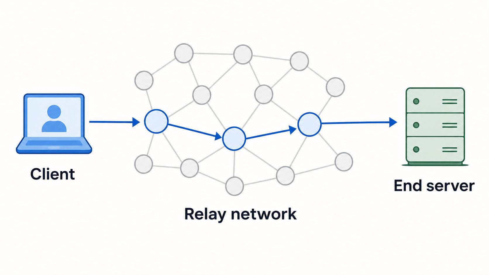
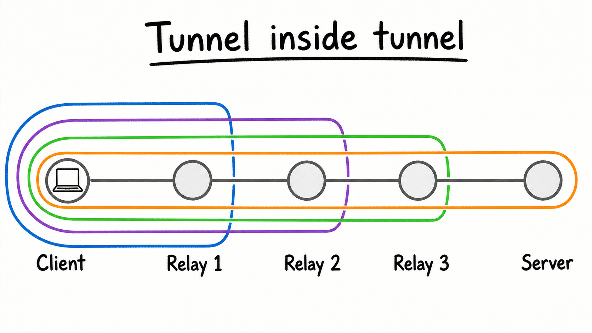

# Tor: The Onion Router

### IIC2531 — Clase 20

Anonimato en red mediante enrutamiento en capas:
circuitos, hidden services y sus límites.

---

# El problema: metadatos

- Una conexión normal revela **quién** habla con **quién**.
- El adversario ve IP de origen, IP de destino, hora y volumen.
- El cifrado protege el **contenido**, no los metadatos.
- Tor no oculta que alguien usa Tor: oculta **qué** usuario habla con **qué** servidor.

---

# Anonimato y sus límites

- **Anonimato:** el adversario no puede vincular usuarios con servidores.
- Se asume que el adversario **sabe** que existe tráfico Tor.
- Objetivo doble: anonimato para **clientes** y para **servidores**.
- Cifrar es necesario, pero insuficiente: los paquetes cifrados aún se pueden rastrear.
- Sin adversario global, el anonimato depende de **mezclar** con otros usuarios.

---

# Mezclar tráfico

- El anonimato requiere **muchedumbre**: muchos usuarios con comportamiento similar.
- Si todos usan BitTorrent, un usuario de Wikipedia resalta.
- Si todos usan Firefox, un usuario de Chrome resalta.
- El nodo de mezcla debe **transformar** los paquetes (cifrar/descifrar).
- Si el paquete sale idéntico, se puede seguir su rastro.
- Idea: retransmitir por intermediarios que reescriben el tráfico.

---

# ¿Por qué más de un nodo?

- **Escalabilidad:** repartir el tráfico entre muchos nodos.
- **Compromiso:** un nodo comprometido solo ve a sus vecinos directos.
- Con muchos nodos independientes, el daño se limita a una fracción del tráfico.
- En onion routing, romper el anonimato exige comprometer **toda la cadena**.
- El **análisis de tráfico** (timing y volumen) sigue siendo posible.
- Observar el primer y el último nodo suele bastar para correlacionar.

---

# Onion routing: idea central

- Malla de **onion routers (ORs)** con llaves públicas conocidas.
- El cliente **elige una ruta** y cifra el mensaje con la llave de cada OR, en orden.
- El primer OR descifra una capa y reenvía; el siguiente hace lo mismo.
- El **exit node** entrega los datos a la red real.
- Cada OR solo conoce el **hop anterior y el siguiente**.
- Con dos ORs, comprometer uno solo no rompe el anonimato.
- Es la base conceptual; Tor agrega circuitos, directorio y defensas.

---

# Capas de cifrado

- Cada capa se abre en un nodo distinto, como una cebolla.
- El paquete mantiene **tamaño constante** sin importar la longitud de la ruta.
- Solo el último OR conoce el destino real.

---

# Circuitos y streams

- **Circuito:** ruta de ORs que el cliente construye y mantiene por minutos.
- Cada circuito tiene llaves simétricas (AES) compartidas con cada OR.
- **Stream:** equivale a una conexión TCP dentro del circuito.
- Muchos streams viajan sobre el mismo circuito, cada uno con su ID.
- Reutilizar el circuito evita reconstruirlo para cada conexión.
- Los circuitos se renuevan periódicamente para frustrar correlación.

---

# ¿En qué nivel retransmitir?

- **IP:** máxima generalidad, pero filtra headers TCP y detalles identificables.
- **TCP:** buen equilibrio; Tor usa SOCKS a nivel TCP.
- **HTTP:** más eficiente, pero expone headers, cookies y JavaScript.
- Tor elige TCP: no necesita control de flujo propio y evita fugas de capas bajas.
- Costo: UDP no funciona, tampoco traceroute ni algunos protocolos.
- Regla general: a más bajo nivel, más general; a más alto, más anonimato y eficiencia.

---

# Diseño de Tor: nodos, claves y directorio

- Malla de ORs conectados por TLS; no dependen de CAs públicas.
- Cada OR tiene **identity key** (firmada y registrada) y **onion key** (efímera).
- La identity key firma la onion key actual, limitando el daño de un compromiso.
- Los **servidores de directorio** aprueban ORs y publican su estado.
- Sin directorio, un atacante podría inundar la red con nodos propios.
- Los ORs son operados por **voluntarios**; no hay una autoridad central fuerte.
- Consultar el directorio no rompe el anonimato: no requiere conexión en línea.

---

# Construcción de circuitos

- El cliente descarga la lista de ORs y elige la cadena él mismo.
- Construir desde el cliente evita que un OR "desvíe" el circuito.
- Se extiende salto por salto con intercambio de llaves Diffie-Hellman.
- Cada extensión usa `relay extend`; solo el cliente conoce la ruta completa.
- Las celdas son de **tamaño fijo** para dificultar el análisis de tráfico.
- Los IDs de circuito son **por enlace**, no globales.
- Circuitos de corta duración evitan vincular varios streams de un mismo usuario.

---

# Hidden services: publicación

- Permiten que el **servidor** sea anónimo, no solo el cliente.
- El nombre `publickey.onion` identifica una llave, no una IP.
- Bob elige **puntos de introducción** y publica un descriptor firmado.
- El descriptor vive en directorios de hidden services (HSDirs).
- Alice resuelve el `.onion` descargando ese descriptor.
- Los puntos de introducción saben contactar a Bob, pero no reciben datos de la aplicación.

---

# Rendezvous: conectar a ambos

- Alice elige un OR como **punto de rendezvous (RP)** y crea un circuito hacia él.
- Envía a Bob, vía punto de introducción, el RP y una **cookie**.
- Bob crea su propio circuito hacia el RP y prueba conocer la cookie.
- El RP une ambos circuitos y reenvía celdas entre ellos.
- Los datos van cifrados con una llave compartida entre Alice y Bob.
- Cada uno controla su propio anonimato y desconoce la ruta del otro.

---

# ¿Qué aprende cada parte?

- **Punto de introducción:** alguien quiere contactar a Bob; no ve los datos.
- **Punto de rendezvous:** retransmite, pero no sabe qué servicio `.onion` es.
- **Alice:** no aprende la IP real de Bob.
- **Bob:** no aprende la IP real de Alice.
- La división evita cargar tráfico en los puntos de introducción.
- También evita que un punto de introducción reenvíe datos ilegales de forma identificable.

---

# Censura y bridges

- Bloquear Tor es fácil si se conocen todas las IPs de los ORs.
- Los **bridges** son nodos no listados que dan entrada a la red.
- El directorio entrega pocas direcciones a la vez, no una enumeración completa.
- Los **pluggable transports** permiten cambiar rápido la forma del tráfico.
- Objetivo: que el censor no pueda distinguir Tor de tráfico legítimo.
- Es una carrera continua entre censores y desarrolladores.

---

# Ataques: extremo a extremo y timing

- Si el atacante controla el **primer y último hop**, identifica el circuito.
- Puede correlacionar tiempos y volúmenes entre entrada y salida.
- Retrasar paquetes selectivamente también revela información.
- La probabilidad de compromiso crece con cada circuito: aproximadamente `C·(M/N)²`.
- Con el tiempo, esa probabilidad se acerca a 1.
- Defensa parcial: ejecutar tu propio OR para observar el tráfico de entrada/salida.

---

# Guard nodes

- Insight: elegir el **primer nodo una sola vez** y mantenerlo mucho tiempo.
- Si el guard es honesto, el primer salto deja de ser una incógnita.
- Si es malicioso (probabilidad `M/N`), queda el riesgo del último nodo.
- La probabilidad total se estabiliza en `M/N` en vez de crecer hasta 1.
- Trade-off: menos rotación mejora la seguridad, pero reduce la diversidad de rutas.
- Los guards son una defensa clave contra ataques de compromiso prolongado.

---

# Límites, alternativas y cierre

- **Fugas de aplicación:** JavaScript, headers HTTP, DNS y plugins.
- **Fingerprinting:** comportamiento, horarios de circuitos, sitios visitados.
- **ORs maliciosos:** mucho ancho de banda y política de salida abierta.
- Mitigaciones: proxy de aplicación, celdas fijas y diversidad de rutas.
- **DC-nets**: cada par comparte un secreto y todos publican XOR.
- Ofrecen seguridad más fuerte que Tor, pero con costo enorme en rendimiento.
- Tor no es anonimato absoluto: es una mejora probabilística y práctica.

---

# Pregunta de prueba 1

**¿Por qué cifrar el tráfico no basta para lograr anonimato?**

**Respuesta:**

- El cifrado oculta el contenido, pero no los metadatos.
- El adversario aún ve IPs, horarios, volúmenes y patrones.
- Sin mezclar con otros usuarios, el tráfico se puede correlacionar.
- Tor necesita muchos usuarios similares para diluir a cada uno.

---

# Pregunta de prueba 2

**Explica cómo onion routing evita que un solo nodo comprometido rompa el anonimato.**

**Respuesta:**

- El cliente cifra el mensaje con las llaves de todos los ORs en orden.
- Cada OR descifra solo su capa y conoce únicamente sus vecinos.
- Ningún nodo intermedio ve origen y destino a la vez.
- Se necesitaría comprometer toda la cadena, o al menos entrada y salida.

---

# Pregunta de prueba 3

**¿Cómo se conectan Alice y Bob a un hidden service sin revelar sus IPs?**

**Respuesta:**

- Bob publica puntos de introducción en un descriptor firmado.
- Alice elige un punto de rendezvous y avisa a Bob vía punto de introducción.
- Bob se conecta al rendezvous y prueba conocer la cookie.
- El RP une ambos circuitos; ninguno aprende la IP del otro.

---

# Pregunta de prueba 4

**¿Qué problema resuelven los guard nodes y cuál es su trade-off?**

**Respuesta:**

- Sin guards, la probabilidad de elegir un primer nodo malicioso crece con cada circuito.
- Fijar un guard honesto elimina ese riesgo de forma permanente.
- La probabilidad de compromiso se acota en `M/N` en vez de llegar a 1.
- Trade-off: menos rotación reduce la diversidad de rutas de entrada.
